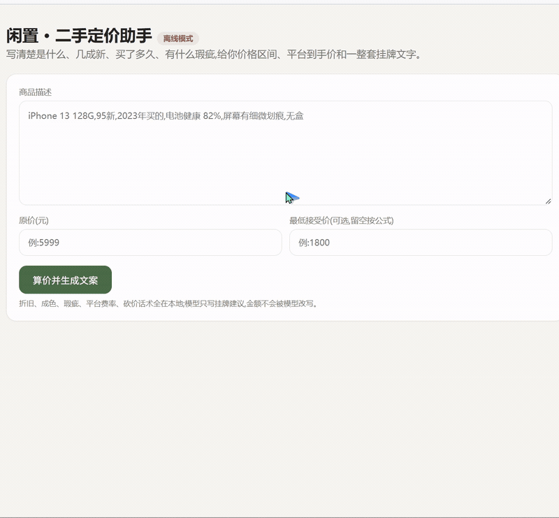
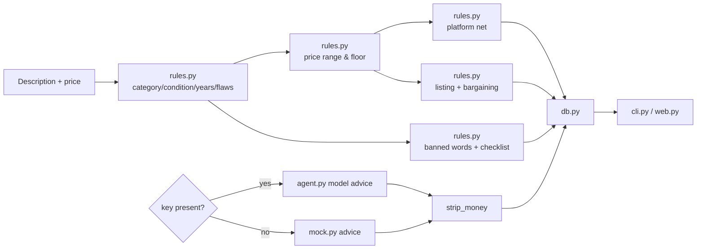

# XianZhi · Second-hand Pricing Assistant

[](https://github.com/wushiyi105-jpg/xianzhi/actions) []() [](./LICENSE) [](https://codecov.io/gh/wushiyi105-jpg/xianzhi)



> Price a used item: depreciation, condition and flaws give a range and a floor, plus net proceeds per platform, a ready-to-post listing and three bargaining replies.

The hard part of selling second-hand is not posting — it is **pricing**. Too high and nobody asks, too low and it is gone in an hour, and only afterwards do you realise you undersold. Depreciation, flaw deductions and platform fees are all arithmetic. Do that first, then write the listing.

**CLI + Web, zero third-party dependencies.**

## ✨ Features

- 🏷 **8 category models** — phone, computer, camera, appliance, furniture, fashion, baby, books/instruments, each with first-year retention, yearly decay and a residual floor
- ✨ **5 condition grades** — new 1.00 / 99% 0.86 / 95% 0.72 / 90% 0.58 / 80% and below 0.40
- 🩹 **5 flaw types** — appearance, battery, repair, missing parts, malfunction, 5%–20% each, capped at 30%
- 💰 **Range and floor** — suggested ×0.85–1.12 is the listing range, ×0.80 is the bargaining floor
- 🏪 **4 platform net prices** — Xianyu 0%, Zhuanzhuan 1.5%, Aihuishou 0%, Hongbulin 10%
- 📝 **Listing copy** — title ≤30 characters, body with condition / purchase / flaws / parts / transaction, five tags
- 🗣 **Three bargaining tiers** — 5%, 12%, 25%, holding the floor
- 🚫 **Banned-word scan** — 12 words in four groups (counterfeit, off-platform, absolute claims, prohibited), each with a rewrite
- 📷 **Listing check** — photos, serial, receipt, flaw disclosure, parts, transaction method
- 🔒 **Amounts are local-only** — the model writes advice and risks; any price in its output is replaced by `strip_money`

## 🚀 Quick start

```bash
git clone https://github.com/wushiyi105-jpg/xianzhi.git
cd xianzhi

cp .env.example .env      # optional: LLM_API_KEY

python -m xianzhi quote --text "iPhone 13 128G, 95% new, bought 2023, battery 82%, light screen scratches, no box" --original 5999
```

Or keep the description in `item.txt` and run `python -m xianzhi quote --file item.txt --original 5999 --save`.

Docker:

```bash
docker build -t xianzhi .
docker run -p 8000:8000 xianzhi
```

## 🤔 Why not just ask a general LLM

A general model says "check recent sales and list around 3,000". That number cannot be recomputed and you cannot tell whether you lost money. Four differences:

1. **Every number can be recomputed** — `rules.price()` uses `original × first-year retention × decay^(years-1) × condition × (1 - flaws)`, floored at `original × residual floor`. Input 5999, bought 2023, 95%, scratches + battery + no box, and the answer is always 1042. Anyone can reproduce it; "around 3,000" has no intermediate steps.
2. **Range and floor are separate** — listing range 886–1167, floor 834. Three numbers with three jobs: the range to list, the floor to hold. A single model number gives you no anchor when someone bargains.
3. **Platform fees reach the net price** — Hongbulin's 10% means listing at 1042 nets 938, 104 less than Xianyu. Only arithmetic makes that visible.
4. **Works offline** — pricing, platforms, copy, bargaining, banned words and checklist are all local; without a key you only lose the model's advice paragraphs.

## 🎯 Use cases

- **Before upgrading a phone**: 95% new, scratches, no box — see the range and floor, then decide between a slow Xianyu sale and a fast trade-in.
- **Moving out, selling furniture**: furniture depreciates fastest (45% first year, ×0.85 per year); the tool suggests bundling rather than listing piece by piece until moving day.
- **Can't write the listing**: title, body and tags in one go, with flaws stated on line two to reduce post-sale haggling.
- **Tired of lowballs**: three tiers tell you 5% is fine, 12% needs a counter, 25% is a polite no.

## 🗺 Roadmap

- **Comparable sales**: pull public sold prices and show formula price next to market price, flagging gaps over 15%.
- **Multi-platform repricing**: platform-specific title lengths and tags, keeping a price history.
- **Photo guide per category**: required angles, with a completeness check.
- **Post-sale haggling library**: replies for "not as described", "malfunction", "shipping dispute".
- **Batch clearance**: enter several items, get a bundling order and combination suggestion.

## ❓ FAQ

**No original price?**
Then only the method is possible, not a number: the tool asks for the price and purchase year. Alternatively use the median of recent sold prices minus 5%–8%.

**How is condition judged?**
By keywords: unopened, 99% / opened only, 95% / light use, 90% / normal wear, 80% / dents. Default is 95%, and the coefficient is printed so you can change it.

**Can flaws be double-counted?**
They add up but are capped at 30% (`rules.FLAW_CAP`), so "scratched and water-damaged" does not become a giveaway. Each deduction lives in `data/categories.json`.

**Are the platform fees accurate?**
They follow published rates; Xianyu's software fee on some categories, Zhuanzhuan's inspection fee and Hongbulin's authentication fee are called out separately rather than folded into the rate.

**Will the model change the price?**
No. `agent.strip_money()` replaces any "N yuan" in model output with a placeholder; prices come only from `rules.price()`.

## 📖 Commands

```bash
# 🏷 quote + listing
python -m xianzhi quote --text "..." --original 5999
python -m xianzhi quote --file item.txt --original 5999 --save

# 🏪 platform fees
python -m xianzhi platforms

# 🚫 banned words
python -m xianzhi banned

# 🗂 history
python -m xianzhi history

# 🌐 web
python -m xianzhi web --port 8000

python -m xianzhi --json quote --text "..." --original 5999
python -m xianzhi --mock quote --text "..." --original 5999
```

## 🔌 Model configuration

Any **OpenAI-style `/chat/completions`** endpoint:

| Platform | `LLM_BASE_URL` | `LLM_MODEL` |
|---|---|---|
| DeepSeek (default) | `https://api.deepseek.com` | `deepseek-flash` |
| OpenAI | `https://api.openai.com/v1` | `gpt-4o-mini` |
| Local Ollama | `http://localhost:11434/v1` | `qwen2.5` |

## 🧠 How it works

```
description + original price
  │
  ├─ rules.detect_category ── 8 categories
  ├─ rules.detect_condition ─ 5 grades
  ├─ rules.detect_years ───── "bought 2023" / "used 3 years"
  ├─ rules.detect_flaws ───── 5 flaw types
  ├─ rules.price ──────────── residual → condition → flaws → range/floor
  ├─ rules.platform_net ───── 4 platforms after fees
  ├─ rules.listing ────────── title/body/tags
  ├─ rules.bargaining ─────── three tiers
  ├─ rules.banned ─────────── 12 banned words
  │
  ├─ model: advice / risks / buyer questions (strip_money)
  └─ offline: mock.py assembles from category and flaws
  │
  └─ SQLite → CLI / Web
```

### Data flow



## 🗂 Layout

```
xianzhi/
├── xianzhi/
│   ├── rules.py    # depreciation, condition, flaws, platforms, copy, bargaining
│   ├── agent.py    # orchestration + price stripping
│   ├── mock.py     # offline advice
│   ├── db.py       # saved quotes
│   ├── cli.py      # quote / platforms / banned / history / web
│   └── web.py      # single page + JSON API
├── data/
│   ├── categories.json  # 8 categories + 5 grades + 5 flaws
│   ├── platforms.json   # 4 platform fees
│   └── banned.json      # 12 banned words
├── tests/test_xianzhi.py
└── assets/demo.gif
```

## ✅ Tests

```bash
python -m unittest discover tests -v
```

27 tests cover local logic only: category detection, year parsing, depreciation formula, residual floor, flaw deduction and cap, range ordering, platform net, banned words, title length, bargaining tiers, checklist, offline pipeline and price stripping. CI runs them on 3.10/3.11/3.12.

## 👤 Author

shiyi · GitHub [@wushiyi105-jpg](https://github.com/wushiyi105-jpg) · [wushiyi105@gmail.com](mailto:wushiyi105@gmail.com)

## 📄 License

[MIT](./LICENSE)
