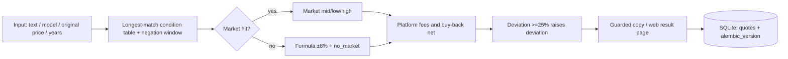

# xianzhi · second-hand pricing


Tell it what you're selling; get a price you can list at, copy that sells, and answers for haggling.

## Features

- **Market anchor**: 10 models in `data/market.json` carry estimated ranges; a hit returns mid/low/high, a miss falls back to the formula with a ±8% band and an explicit `pricing.no_market` note.
- **Condition factors**: longest-match table (`九成新` = 0.58 is not stolen by `9成新`), with a 3-character negation window so `无磕碰` is not penalised.
- **Depreciation**: digital 0.55 in year one then ×0.82 per year; appliances 0.68 then ×0.92 with a 0.30 floor.
- **Net proceeds**: Xianyu 0%, Zhuanzhuan 1%, Aihuishou buy-back at 0.80 of list price, Hongbulin 15%; a buy-back below 85% of list raises `fees.recycle_gap`.
- **Deviation warning**: formula price ≥25% away from market price raises `pricing.deviation`.
- **Number guard**: any sentence in model-written copy that cites a number not present in the input is dropped whole.
- **CLI + Web**: one command for a price, one page for range and net proceeds.

## Quick start

```bash
uv sync --extra dev
uv run xianzhi quote --text "iPhone 13 128G 九成新 用了 3 年 无拆修" --model "iPhone 13 128G" --original 5999 --years 3
uv run xianzhi serve            # http://127.0.0.1:8000
```

Measured on that exact input: list at ¥1525, range ¥1408–1642, floor ¥1309; net ¥1525 on Xianyu, ¥1510 on Zhuanzhuan, ¥1220 via Aihuishou, ¥1296 on Hongbulin, plus a `fees.recycle_gap` finding.
26 tests, 85% line coverage (`uv run coverage report`).

## Why not just ask a general model

Hand "iPhone 13, 90% new" to a general model and you get a number, but:

1. **It doesn't price condition** — 0.58 vs 0.72 is 14 points of difference, and it eyeballs it;
2. **It misreads negation** — "no repairs" regularly becomes "repaired";
3. **It ignores payout mechanics** — Aihuishou pays 80% of list, Hongbulin takes 15%;
4. **It invents numbers** — which is why copy here must pass the number guard.

xianzhi keeps condition factors, defect detection and platform fees in local code; the model only writes copy.

## Who it's for

- People selling three or more items a year who don't want to re-check the market each time;
- People unsure what to list at, afraid of pricing themselves out;
- People comparing "sell it myself" against "hand it to a buy-back service".

## Roadmap

- [ ] Replace estimated market data with real sold-price samples (`samples=null` today)
- [ ] City/season adjustments for appliance residuals
- [ ] Batch import of several items, one pricing pass
- [ ] Feed actual sale prices back to build a personal deviation curve

## FAQ

**Is the price accurate?**
Accurate enough to pick a listing tier, not a contract price. The 10 models are estimated ranges with no sample size, and every output states the provenance; condition factors and fees are hard rules and reproducible.

**Does it work without an API key?**
Yes. `quote`, `history` and `serve` are fully offline; only `listing` needs a model and prints "offline mode: no API key, quote only" otherwise.

**What about my old 0.x database?**
Run `xianzhi migrate --db data/xianzhi.db`. It backs up to `xianzhi.bak-<timestamp>.db` first, converts yuan-denominated rows into the cents schema, and exits 2 without touching the file when the schema is unrecognised.

**Why ±8%?**
An empirical band for the no-market case, not a confidence interval. On a market hit the band comes from the market table itself.

## Commands

```bash
xianzhi quote --text "..." [--model MODEL] [--original PRICE] [--years N] [--json] [--db PATH]
xianzhi listing --text "..." [--model MODEL] [--original PRICE] [--years N]   # needs API key
xianzhi history [--limit 10] [--db PATH]
xianzhi migrate [--db PATH] [--force]        # 0.x migration, backs up first
xianzhi serve [--port 8000] [--db PATH]
xianzhi doctor [--db PATH]                   # config / database / market / llm / webhook
```

## Dependencies

Runtime: `fastapi`, `uvicorn`, `jinja2`, `python-multipart`, `pydantic` + `pydantic-settings` (prefix `XZ_`), `httpx`, `typer` + `rich`, `sqlalchemy` + `alembic`.
Dev: `pytest`, `pytest-cov`, `ruff` (line-length 100), `mypy` (`ignore_missing_imports`).
Python ≥3.10; the image is `python:3.10-slim`, two-stage, `EXPOSE 8000`.

## How it works



Rules live in `domain/rules/`, storage and migration in `adapters/`; CLI and Web only render, they never decide.

## Layout

```
xianzhi/
├── xianzhi/
│   ├── domain/          # models, engine, guard, rules/{condition,pricing,fees}
│   ├── adapters/        # store.py, migrate.py, llm.py
│   ├── iface/           # cli.py (Typer), web.py (FastAPI + Jinja2)
│   ├── config.py        # XZ_ prefixed settings
│   └── doctor.py
├── migrations/          # alembic env + versions/0001_init.py
├── data/market.json     # 10 models with provenance
├── templates/
├── tests/               # 26 tests: flow / pricing / guard / migrate / iface
├── Dockerfile           # python:3.10-slim, EXPOSE 8000
└── .github/workflows/test.yml
```

## Author

Xiaomi · GitHub [@wushiyi105-jpg](https://github.com/wushiyi105-jpg) · 17612850106
