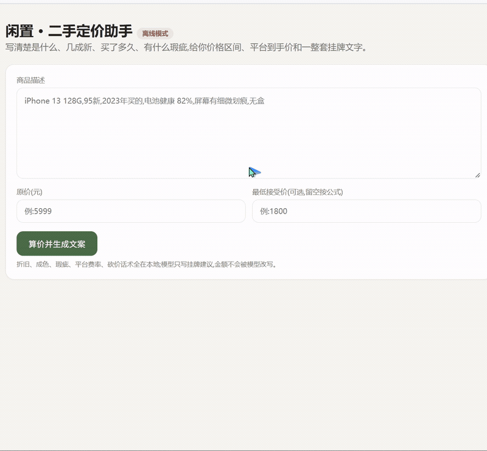
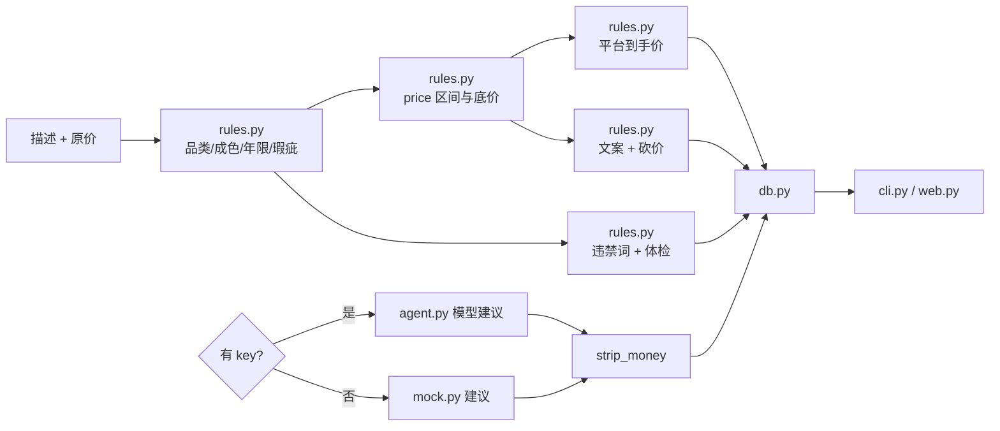

# 闲置 · 二手定价助手

[](https://github.com/wushiyi105-jpg/xianzhi/actions) []() [](./LICENSE) [](https://codecov.io/gh/wushiyi105-jpg/xianzhi)



> 闲置物品报个价:按品类折旧、成色、瑕疵算出区间与底价,再给平台到手价、挂牌文案和三档砍价应答。

二手最难的不是发帖,是**定价**:挂高了没人问,挂低了当天被秒,事后才反应过来亏了。折旧到底怎么算、瑕疵该减多少、平台抽成后还剩多少,这几件事其实都能算。算完再写文案,比凭感觉标价靠谱。

**CLI + Web,零第三方依赖。**

## ✨ 特性

- 🏷 **8 类目折旧模型** — 手机、电脑、相机、家电、家具、服饰、母婴、图书乐器,各有首年留存率、年衰减系数与残值下限
- ✨ **5 档成色系数** — 全新 1.00 / 99新 0.86 / 95新 0.72 / 9成新 0.58 / 8成及以下 0.40
- 🩹 **5 类瑕疵扣减** — 外观、电池、拆修、缺配件、功能异常,单项 5%–20%,总扣减封顶 30%
- 💰 **区间与底价** — 建议价 ×0.85–1.12 为挂牌区间,×0.80 为砍价底价
- 🏪 **4 个平台到手价** — 闲鱼 0%、转转 1.5%、爱回收 0%、红布林 10%,按费率直接算净收入
- 📝 **挂牌文案** — 标题 ≤30 字,正文含成色/购入/瑕疵/配件/交易方式,附 5 个标签
- 🗣 **砍价三档应答** — 小刀 5%、中刀 12%、大刀 25%,底价以下不松口
- 🚫 **违禁词扫描** — 12 个词分四类(假货、导流、绝对化、违规),给出替代写法
- 📷 **挂牌体检** — 实拍图、序列号、凭证、瑕疵说明、配件、交易方式,6 项逐条判定
- 🔒 **金额只认本地** — 模型只写挂牌建议与风险,输出里的价格会被 `strip_money` 替换

## 🚀 快速开始

```bash
git clone https://github.com/wushiyi105-jpg/xianzhi.git
cd xianzhi

cp .env.example .env      # 可选:LLM_API_KEY

python -m xianzhi quote --text "iPhone 13 128G,95新,2023年买的,电池82%,屏幕细微划痕,无盒" --original 5999
```

也可以把描述写进 `item.txt`:`python -m xianzhi quote --file item.txt --original 5999 --save`。

Docker:

```bash
docker build -t xianzhi .
docker run -p 8000:8000 xianzhi
```

## 🤔 为什么不能直接问通用大模型

通用模型会说「参考同款成交价,挂 3000 左右」。这个数字既不可复算,也不知道你亏没亏。差别在四点:

1. **每个数字都能复算** — `rules.price()` 的公式是 `原价 × 首年留存 × 年衰减^(年数-1) × 成色 × (1-瑕疵)`,并受 `原价×残值下限` 托底。输入 5999、2023 年购入、95新、划痕+电池+无盒,结果固定是 1042 元,任何人按公式都能算出来。模型给的「3000 左右」没有中间过程,错也不知道错在哪。
2. **底价与区间是分开的** — 挂牌区间 886–1167、底价 834,三个数各有用途:区间用来挂,底价用来守住。模型通常只给一个数,砍价时就没有锚点。
3. **平台抽成算进到手价** — 红布林 10% 意味着挂 1042 只能拿 938,和闲鱼差 104 元。这个差额只有按费率算才看得见,模型往往忽略。
4. **断网也能出全套** — 定价、平台、文案、砍价、违禁词、体检全在本地;没有 key 只少「挂牌建议」那几句。

## 🎯 适用场景

- **换手机前先估价**:旧机 95新、有划痕、无盒,先看区间与底价,再决定是挂闲鱼慢慢卖,还是直接爱回收省事。
- **家具/家电搬家急出**:按家具类目折旧(首年 45%、每年 ×0.85),看到"打包卖比单件好"的建议,避免一件件挂到搬家当天。
- **写不出文案**:标题、正文、标签一次生成,瑕疵主动写在第二行,减少到手刀。
- **被砍到怀疑人生**:用三档应答,知道 5% 可以让、12% 要守中位、25% 直接婉拒。

## 🗺 Roadmap

- **同款成交价参照**:接入平台公开成交数据,把「公式价」与「市场价」并列显示,偏差超过 15% 时提示。
- **多平台一键改价**:生成各平台适配的标题长度与标签,批量改价时保留历史。
- **成色拍照指引**:按品类给出必拍角度清单,拍完自动检查是否齐全。
- **到手刀应对库**:按买家常见话术(描述不符、功能异常、运费争议)给出可直接复制的回应。
- **批量清仓**:一次录入多件,按总价与体积给出打包顺序和组合建议。

## ❓ FAQ

**没有原价怎么办?**
只能给方法给不了价:系统会提示补原价与购入年份。也可以按同型号近 7 天成交价中位数,再减 5%–8% 作为挂牌价。

**成色怎么判?**
按关键词:`全新未拆`、`99新/仅拆封`、`95新/轻微使用`、`9成新/正常痕迹`、`8成新/磕碰掉漆`。没写就默认 95新,并在结果里标出系数,方便你改。

**瑕疵会不会重复扣?**
会累加但封顶 30%(`rules.FLAW_CAP`),避免「有划痕又进水」被算成近乎白送。每项扣减比例在 `data/categories.json` 的 `flaws` 里。

**平台费率准吗?**
按公开费率写的,闲鱼部分类目会收软件服务费、转转有验机费、红布林有鉴定费,这些在结果里单独提示,不并入费率。

**模型会不会改价?**
不会。`agent.strip_money()` 把模型输出里的「N 元」替换成「该价格」,价格只来自 `rules.price()`。

## 📖 命令参考

```bash
# 🏷 估价 + 文案
python -m xianzhi quote --text "..." --original 5999
python -m xianzhi quote --file item.txt --original 5999 --save

# 🏪 平台费率
python -m xianzhi platforms

# 🚫 违禁词
python -m xianzhi banned

# 🗂 历史估价
python -m xianzhi history

# 🌐 Web
python -m xianzhi web --port 8000

python -m xianzhi --json quote --text "..." --original 5999
python -m xianzhi --mock quote --text "..." --original 5999
```

## 🔌 模型配置

兼容 **OpenAI `/chat/completions`** 的任意服务:

| 平台 | `LLM_BASE_URL` | `LLM_MODEL` |
|---|---|---|
| DeepSeek(默认) | `https://api.deepseek.com` | `deepseek-flash` |
| OpenAI | `https://api.openai.com/v1` | `gpt-4o-mini` |
| 本地 Ollama | `http://localhost:11434/v1` | `qwen2.5` |

## 🧠 工作原理

```
商品描述 + 原价
  │
  ├─ rules.detect_category ── 8 类目关键词
  ├─ rules.detect_condition ─ 5 档成色
  ├─ rules.detect_years ───── 「2023年买」/「用了3年」
  ├─ rules.detect_flaws ───── 5 类瑕疵
  ├─ rules.price ──────────── 残值 → 成色 → 瑕疵 → 区间/底价
  ├─ rules.platform_net ───── 4 平台扣除费率
  ├─ rules.listing ────────── 标题/正文/标签
  ├─ rules.bargaining ─────── 三档应答
  ├─ rules.banned ─────────── 12 个违禁词
  │
  ├─ 模型:挂牌建议 / 风险 / 买家问题(strip_money)
  └─ 离线:mock.py 按品类与瑕疵组装
  │
  └─ SQLite → CLI / Web
```

### 数据流



## 🗂 目录结构

```
xianzhi/
├── xianzhi/
│   ├── rules.py    # 折旧、成色、瑕疵、平台、文案、砍价、违禁词
│   ├── agent.py    # 编排 + 金额剥离
│   ├── mock.py     # 离线建议与风险
│   ├── db.py       # 估价记录
│   ├── cli.py      # quote / platforms / banned / history / web
│   └── web.py      # 单页 + JSON API
├── data/
│   ├── categories.json  # 8 类目 + 5 成色 + 5 瑕疵
│   ├── platforms.json   # 4 平台费率
│   └── banned.json      # 12 个违禁词
├── tests/test_xianzhi.py
└── assets/demo.gif
```

## ✅ 测试

```bash
python -m unittest discover tests -v
```

27 个单测只测本地逻辑:品类识别、年限解析、折旧公式、残值下限、瑕疵扣减与封顶、区间顺序、平台净额、违禁词、标题长度、砍价三档、体检项、离线全流程、金额剥离。CI 在 3.10/3.11/3.12 上跑。

## 👤 作者

shiyi · GitHub [@wushiyi105-jpg](https://github.com/wushiyi105-jpg) · [wushiyi105@gmail.com](mailto:wushiyi105@gmail.com)

## 📄 许可

[MIT](./LICENSE)
