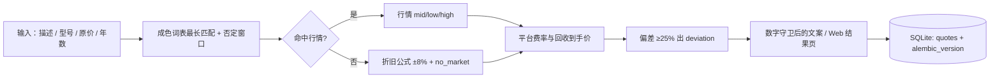

# xianzhi · 二手定价


说清楚要卖什么，给一个敢挂的价格、一段能卖掉的文案、一套应付砍价的话。

## 功能特性

- **行情锚定**：`data/market.json` 里 10 个型号有估算区间，命中就用 mid/low/high；没命中退回公式，输出 ±8% 区间并明说"仅公式参考，通常偏低"
- **成色折算**：最长词匹配（`九成新`=0.58 不会被 `9成新` 抢走），前 3 个字窗口过滤否定词（`无磕碰` 不扣价）
- **折旧公式**：数码首年 0.55、之后每年 ×0.82；家电首年 0.68、每年 ×0.92、地板价 0.30
- **到手价对比**：闲鱼 0%、转转 1%、爱回收按挂价 0.80 回收、红布林 15%；回收价低于挂价 85% 出 `fees.recycle_gap`
- **偏差提示**：公式价与行情价差 ≥25% 出 `pricing.deviation`
- **数字守卫**：模型写出的文案里出现输入之外的数字，整句丢
- **CLI + Web**：一条命令出价，网页一眼看区间与到手

## 快速开始

```bash
uv sync --extra dev
uv run xianzhi quote --text "iPhone 13 128G 九成新 用了 3 年 无拆修" --model "iPhone 13 128G" --original 5999 --years 3
uv run xianzhi serve            # http://127.0.0.1:8020
```

实测这一段输出：建议挂 1525 元，区间 1408–1642，底价 1309；闲鱼 1525 / 转转 1510 / 爱回收 1220 / 红布林 1296，并给出 `fees.recycle_gap`。
本仓 26 条测试，行覆盖 85%（`uv run coverage report` 自查）。

## 为什么不用通用大模型直接问

把"iPhone 13 九成新"丢给通用模型，它给你一个数，但：

1. **不算成色**——九成新 0.58 和 95新 0.72 差 14 个点，它靠感觉；
2. **读不懂否定**——"无拆修"常被当成"拆修过"；
3. **不知道到手机制**——爱回收按挂价 8 折、红布林抽 15%，它不提；
4. **会编数字**——所以这里的文案必须过数字守卫，引用了不存在的价位就整句删。

xianzhi 把成色系数、瑕疵识别、平台费率都放到本地代码里，模型只负责写文案。

## 适用场景

- 一年卖 3 件以上闲置，懒得每次重新查行情的人；
- 不确定该挂多少、怕喊高了没人问的人；
- 想同时比"挂着卖"和"直接回收"到手差多少的人。

## Roadmap

- [ ] 行情表接入真实成交样本（当前是 2026-11 人工估算，`samples=null`）
- [ ] 支持按城市/季节调整家电残值
- [ ] 批量导入多件闲置，一次出全套价格
- [ ] 挂卖后回填实际成交价，形成自己的偏差曲线

## FAQ

**问：价格准吗？**
不准到"能当合同价"，准到"知道该挂哪一档"。10 个型号是估算区间，没样本量，输出里每次都标来源；成色和费率是硬规则，这部分可复现。

**问：没配 API key 能用吗？**
能。`quote`、`history`、`serve` 全部离线；只有 `listing` 生成文案需要模型，没 key 时打印"离线模式：未配置 API key，只输出报价"。

**问：旧版 0.x 的库怎么办？**
`xianzhi migrate --db data/xianzhi.db`，先备份成 `xianzhi.bak-时间戳.db`，再把旧的元单位报价转成 cents 表；认不出的表结构直接退出码 2，原文件不动。

**问：为什么区间是 ±8%？**
公式没行情时的经验带宽，不是统计置信区间。命中行情时用 mid/low/high，带宽来自行情表本身。

## 命令参考

```bash
xianzhi quote --text "..." [--model 型号] [--original 原价] [--years 年数] [--json] [--db 路径]
xianzhi listing --text "..." [--model 型号] [--original 原价] [--years 年数]   # 生成文案，需 API key
xianzhi history [--limit 10] [--db 路径]
xianzhi migrate [--db 路径] [--force]        # 0.x 旧库迁移，先备份
xianzhi serve [--port 8020] [--db 路径]
xianzhi doctor [--db 路径]                   # 配置 / 数据库 / 行情 / 模型 / webhook 五项
```

## 依赖说明

运行时：`fastapi`、`uvicorn`、`jinja2`、`python-multipart`（表单）、`pydantic` + `pydantic-settings`（配置，前缀 `XZ_`）、`httpx`（模型与 webhook）、`typer` + `rich`（CLI）、`sqlalchemy` + `alembic`（存储与建表）。
开发：`pytest`、`pytest-cov`、`ruff`（line-length 100）、`mypy`（`ignore_missing_imports`）。
Python ≥3.10；容器镜像基于 `python:3.10-slim`，两阶段构建，`EXPOSE 8020`。

## 工作原理



规则全在 `domain/rules/`，存储与迁移在 `adapters/`，CLI/Web 只做展示，不写业务判断。

## 目录结构

```
xianzhi/
├── xianzhi/
│   ├── domain/          # models、engine、guard、rules/{condition,pricing,fees}
│   ├── adapters/        # store.py（SQLAlchemy）、migrate.py、llm.py
│   ├── iface/           # cli.py（Typer）、web.py（FastAPI + Jinja2）
│   ├── config.py        # XZ_ 前缀配置
│   └── doctor.py
├── migrations/          # alembic env + versions/0001_init.py
├── data/market.json     # 10 个型号 + provenance
├── templates/           # 单页表单与结果
├── tests/               # 29 条，flow / pricing / guard / migrate / iface / schema / app
├── Dockerfile           # python:3.10-slim，EXPOSE 8020（本机无 docker，镜像未构建验证）
└── .github/workflows/test.yml
```

## 作者

shiyi · GitHub [@wushiyi105-jpg](https://github.com/wushiyi105-jpg) · wushiyi105@gmail.com
