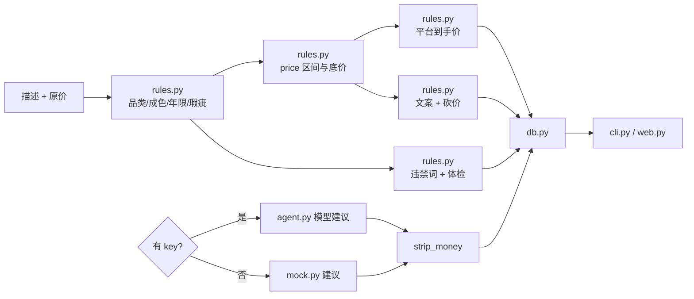

# 闲置 · 二手定价助手

[](https://github.com/wushiyi105-jpg/xianzhi/actions) []() [](./LICENSE) [](https://codecov.io/gh/wushiyi105-jpg/xianzhi)


> 闲置物品报个价:按品类折旧、成色、瑕疵算出区间与底价,再给平台到手价、挂牌文案和三档砍价应答。

二手最难的不是发帖,是**定价**:挂高了没人问,挂低了当天被秒,事后才反应过来亏了。折旧到底怎么算、瑕疵该减多少、平台抽成后还剩多少,这几件事其实都能算。算完再写文案,比凭感觉标价靠谱。

**CLI + Web,零第三方依赖。**

## ✨ 特性

- 🏷 **8 类目折旧模型** — 手机、电脑、相机、家电、家具、服饰、母婴、图书乐器,各有首年留存率、年衰减系数与残值下限
- ✨ **5 档成色系数** — 全新 1.00 / 99新 0.86 / 95新 0.72 / 9成新 0.58 / 8成及以下 0.40
- 🩹 **5 类瑕疵扣减** — 外观、电池、拆修、缺配件、功能异常,单项 5%–20%,总扣减封顶 30%
- 💰 **区间与底价** — 建议价 ×0.85–1.12 为挂牌区间,×0.80 为砍价底价
- 🏪 **4 个平台到手价** — 闲鱼 0%、转转 1.5%、红布林 10% 按费率算；爱回收按回收价收，按挂价 8 折估算（不是抽成，别按 0% 算）
- 📝 **挂牌文案** — 标题 ≤30 字,正文含成色/购入/瑕疵/配件/交易方式,附 5 个标签
- 🗣 **砍价三档应答** — 小刀 5%、中刀 12%、大刀 25%,底价以下不松口
- 🚫 **违禁词扫描** — 12 个词分四类(假货、导流、绝对化、违规),给出替代写法
- 📷 **挂牌体检** — 实拍图、序列号、凭证、瑕疵说明、配件、交易方式,6 项逐条判定
- 🔒 **金额只认本地** — 模型只写挂牌建议与风险,输出里的价格会被 `strip_money` 替换

## 🚀 快速开始

```bash
git clone https://github.com/wushiyi105-jpg/xianzhi.git
cd xianzhi

cp .env.example .env      # 可选:LLM_API_KEY

python -m xianzhi quote --text "iPhone 13 128G,95新,2023年买的,电池82%,屏幕细微划痕,无盒" --original 5999
```

也可以把描述写进 `item.txt`:`python -m xianzhi quote --file item.txt --original 5999 --save`。

Docker:

```bash
docker build -t xianzhi .
docker run -p 8000:8000 xianzhi

# 或直接用镜像(0.1.0 为固定版本,0.1 / latest 跟随最新构建)
docker run --rm -p 8000:8000 ghcr.io/wushiyi105-jpg/xianzhi:0.1.0
```

### 📂 真实文案示例

`examples/` 里四份都是按闲鱼卖家真实写法整理的文案（标题带成色词，正文塞满「无拆修/无进水/支持验机/不议价」，末尾一排标签），`examples/out/` 是实跑输出，首行写生成命令、第二行写运行日期：

```bash
python -m xianzhi --mock quote --file examples/case-01.txt --original 5999
```

| 文件 | 场景 | 原价 | 结果 |
|---|---|---|---|
| `case-01.txt` | iPhone 13 128G，出差备用机 | 5999 | 9成新 · 行情锚点 1525（区间 1408–1642，底价 1220）；公式价 942 偏离 -38% 已提示 |
| `case-02.txt` | 海尔 465L 冰箱，搬家急出 | 4299 | 型号不在行情表 → 回落公式价 1579（区间 1342–1768），并明示「无行情参考、公式值通常偏低」 |
| `case-03.txt` | 索尼 A7M3 单机身 | 12999 | 99新 · 零瑕疵 · 行情锚点 6300（区间 5775–6825） |
| `case-04.txt` | LV Neverfull 中号 | 12000 | 95新 · 命中违禁词「假一赔十」· 行情锚点 4900；公式价 1944 偏离 -60% 已提示 |

这四份文案本身就是回归材料：`九成新` 不等于 `95新`，`无拆修/无进水/屏幕无划痕` 都是否定句不算瑕疵，`电池健康 85%` 才算衰减——每一条都有对应测试。

### 💹 行情估算区间

3C 二手的真实价格由**同型号当前行情**决定，跟当年买多少钱关系不大：iPhone 13 首发 5999，2026 年 11 月的闲鱼正常成交仍在 1500–2200；LV Neverfull 买 12000，二手照样能卖 4900。只按原价线性折旧，这两样都会被算成「明显偏低、一眼被看穿」。

所以定价有两层：

1. `data/market.json` 收录 **29 个主流型号、7 个品类**的当前二手区间（iPhone 13/14/15、小米 13/14、Mate60、iPad Air5、MacBook Air M1、A7M3、EOS R6、戴森 V8、LV Neverfull…）。每一行都带 `meta`：`collected`（采集日期 2026-11）、`platform`（闲鱼/转转在售挂价）、`basis`（`asking` = 在售价，非成交价）、`samples`（样本量——**未做平台抓取，所以是 `null`，不编数字**）。
2. 算价时以行情为主：`行情中位 × 成色调整 × (1 - 瑕疵)`，容量命中不到就回落该型号默认档。型号不在表里才回落到原价折旧公式；两者都有时同时算出公式价，并排显示成「公式折旧 942 · 行情估算 1525 · 偏差 -38% · 两者均为估算，建议按同款二手实际成交价确认」——不写「以行情为准」，因为两边都是估算，谁也不比谁更像事实。

**行情是估算，不是实测。** 这 29 行是 2026-11 按市场挂价量级整理的估算区间：非实时、未抓取、无样本量；成交比挂价低 5%–8% 这一条是**经验值，非统计**。输出里会把这几句原样打出来（`行情来源:2026-11 · 闲鱼/转转(在售挂价,参考) · 样本量:未抓取(无样本量) · 在售挂价(非成交价)`）。

**覆盖不到的部分要自己认。** 内置 29 个型号，其余型号只有公式参考（公式值通常偏低）；型号完全不在表里时，输出会写「⚠️ 无行情参考（内置 29 个型号，本型号不在其中）：公式值通常偏低，建议先搜同款二手成交价」，而不是默默给个低价让你以为算过了。

**公式对家电做了单独校准。** 家电残值不按数码曲线走：4299 的冰箱用四五年，二手挂价 1400–1900（残值 3 成以上），不是 495（11%）。家电把首年留存调到 0.68、年衰减 0.92、下限 30%，并把成色系数压缩（9成新 0.58 → 0.73），避免「折旧 × 成色」二次打折。触到下限时会标「已触到品类下限，实际成交通常更高」。

```bash
# 型号在表里，不填原价也能出价
python -m xianzhi --mock quote --text "iPhone 13 128G 95新 电池健康 85% 无拆修"
```

## 🤔 为什么不用通用大模型直接问

通用模型会说「参考同款成交价,挂 3000 左右」。这个数字既不可复算,也不知道你亏没亏。差别在四点:

1. **锚点选对，数字才可信** — 3C 二手不按原价线性折旧，按同型号当前行情。原价公式（`原价 × 首年留存 × 年衰减^(年数-1) × 成色 × (1-瑕疵)`）只作为参考口径保留，和行情估算偏离超过 30% 时会并排给出两个数并注明「两者均为估算」。iPhone 13 128G 9成新给出 1525 而不是 942，LV Neverfull 给出 4900 而不是 1944。
2. **区间与底价分开** — 建议挂 1525、区间 1408–1642、底价 1220，三个数各有用途：区间用来挂，底价用来守。模型通常只给一个数，砍价时就没有锚点。
3. **平台抽成算进到手价** — 同一台 iPhone 13 挂 1525：闲鱼到手 1525、转转 1502、红布林 1372（10% 抽成）、爱回收 1220（按回收价 8 折收）。这个差额只有按费率算才看得见，模型往往忽略。
4. **断网也能出全套** — 定价、平台、文案、砍价、违禁词、体检全在本地;没有 key 只少「挂牌建议」那几句。

## 🎯 适用场景

- **换手机前先估价**:旧机 95新、有划痕、无盒,先看区间与底价,再决定是挂闲鱼慢慢卖,还是直接爱回收省事。
- **家具/家电搬家急出**:按家具类目折旧(首年 45%、每年 ×0.85),看到"打包卖比单件好"的建议,避免一件件挂到搬家当天。
- **写不出文案**:标题、正文、标签一次生成,瑕疵主动写在第二行,减少到手刀。
- **被砍到怀疑人生**:用三档应答,知道 5% 可以让、12% 要守中位、25% 直接婉拒。

## 🗺 Roadmap

- **行情区间自动更新**:目前 29 个型号的区间是人工整理的 2026-11 估算,计划抓平台在售与成交样本自动刷新,并把窗口收窄到 7 天。
- **多平台一键改价**:生成各平台适配的标题长度与标签,批量改价时保留历史。
- **成色拍照指引**:按品类给出必拍角度清单,拍完自动检查是否齐全。
- **到手刀应对库**:按买家常见话术(描述不符、功能异常、运费争议)给出可直接复制的回应。
- **批量清仓**:一次录入多件,按总价与体积给出打包顺序和组合建议。

## ❓ FAQ

**没有原价怎么办?**
型号在行情表里（29 个主流型号）就直接出行情价，不用填原价，只写到「iPhone 13 128G 95新」就够。型号也不认识、又没原价，才会提示补原价与购入年份。

**行情区间是哪来的?**
人工整理的 2026-11 个人成交估算，标注在 `data/market.json` 的 `note` 里，不假装是抓取的实时数据。你可以直接改这个文件换成本地行情，算价逻辑不用动。

**成色怎么判?**
按命中的关键词判定，长词优先:`全新未拆`、`99新/仅拆封`、`95新/轻微使用`、`9成新/九成新/正常痕迹`、`8成新/磕碰掉漆`。`九成新` 按 9成新（0.58）算，不是 95新；没写就默认 95新，并在结果里标出系数，方便你改。

**瑕疵会不会重复扣?**
会累加但封顶 30%(`rules.FLAW_CAP`),避免「有划痕又进水」被算成近乎白送。每项扣减比例在 `data/categories.json` 的 `flaws` 里。注意否定句不算瑕疵:`无拆修、无进水、屏幕无划痕` 是卖家在说自己没这些问题，`原装电池两块` 是配件而非电池衰减；只有 `无盒`、`没发票` 这类本身就在说「缺什么」的词才计。

**平台费率准吗?**
按公开费率写的,闲鱼部分类目会收软件服务费、转转有验机费、红布林有鉴定费,这些在结果里单独提示,不并入费率。

**模型会不会改价?**
不会。`agent.strip_money()` 把模型输出里的「N 元」替换成「该价格」,价格只来自 `rules.price()`。

## 📖 命令参考

```bash
# 🏷 估价 + 文案
python -m xianzhi quote --text "..." --original 5999
python -m xianzhi quote --file item.txt --original 5999 --save
python -m xianzhi quote --file item.txt --original 5999 --floor 1800   # 自己定底价，默认按建议价 8 折

# 🏪 平台费率
python -m xianzhi platforms

# 🚫 违禁词
python -m xianzhi banned

# 🗂 历史估价
python -m xianzhi history

# 🌐 Web
python -m xianzhi web --port 8000

python -m xianzhi --json quote --text "..." --original 5999
python -m xianzhi --mock quote --text "..." --original 5999
```

## 🔌 模型接入

兼容 **OpenAI `/chat/completions`** 的任意服务:

| 平台 | `LLM_BASE_URL` | `LLM_MODEL` |
|---|---|---|
| DeepSeek(默认) | `https://api.deepseek.com` | `deepseek-flash` |
| OpenAI | `https://api.openai.com/v1` | `gpt-4o-mini` |
| 本地 Ollama | `http://localhost:11434/v1` | `qwen2.5` |

## 🧠 工作原理

```
商品描述 + 原价
  │
  ├─ rules.detect_category ── 8 类目关键词
  ├─ rules.detect_condition ─ 5 档成色
  ├─ rules.detect_years ───── 「2023年买」/「用了3年」
  ├─ rules.detect_flaws ───── 5 类瑕疵
  ├─ rules.price ──────────── 残值 → 成色 → 瑕疵 → 区间/底价
  ├─ rules.platform_net ───── 4 平台扣除费率
  ├─ rules.listing ────────── 标题/正文/标签
  ├─ rules.bargaining ─────── 三档应答
  ├─ rules.banned ─────────── 12 个违禁词
  │
  ├─ 模型:挂牌建议 / 风险 / 买家问题(strip_money)
  └─ 离线:mock.py 按品类与瑕疵组装
  │
  └─ SQLite → CLI / Web
```

### 数据流



## 🗂 目录结构

```
xianzhi/
├── xianzhi/
│   ├── rules.py    # 折旧、成色、瑕疵、平台、文案、砍价、违禁词
│   ├── agent.py    # 编排 + 金额剥离
│   ├── mock.py     # 离线建议与风险
│   ├── db.py       # 估价记录
│   ├── cli.py      # quote / platforms / banned / history / web
│   └── web.py      # 单页 + JSON API
├── data/
│   ├── categories.json  # 8 类目 + 5 成色 + 5 瑕疵
│   ├── platforms.json   # 4 平台费率与回收折价
│   └── banned.json      # 12 个违禁词
├── examples/
│   ├── case-01..04.txt  # 真实闲鱼文案
│   └── out/case-01..04.md  # 实跑输出,首行写生成命令
├── tests/
│   ├── test_xianzhi.py      # 单测:规则函数
│   └── test_integration.py  # 集成:HTTP / 模型层 / CLI
├── Dockerfile
└── assets/demo.gif
```

## ✅ 测试

```bash
python -m unittest discover tests -v
```

81 个用例全部离线可跑，零第三方依赖：62 个单测管本地规则（品类识别、年限解析、折旧公式、残值下限、瑕疵扣减与封顶、否定句与成色词回归、平台净额、违禁词、砍价三档、体检项、金额剥离、行情锚点与偏离提示），19 个集成测试把三条链路真跑一遍——HTTP 真起 `ThreadingHTTPServer` 走 200/404 与入库，模型层用按本仓 schema 返回的假模型验证 `tips/risks/buyer_questions` 解析与金额剥离，CLI 走子进程断言退出码 0/2 与 stderr。CI 在 3.10/3.11/3.12 上跑，并额外构建镜像（打 tag 时推 GHCR）。

## 👤 作者

shiyi · GitHub [@wushiyi105-jpg](https://github.com/wushiyi105-jpg) · [wushiyi105@gmail.com](mailto:wushiyi105@gmail.com)

## 📄 License

[MIT](./LICENSE)
